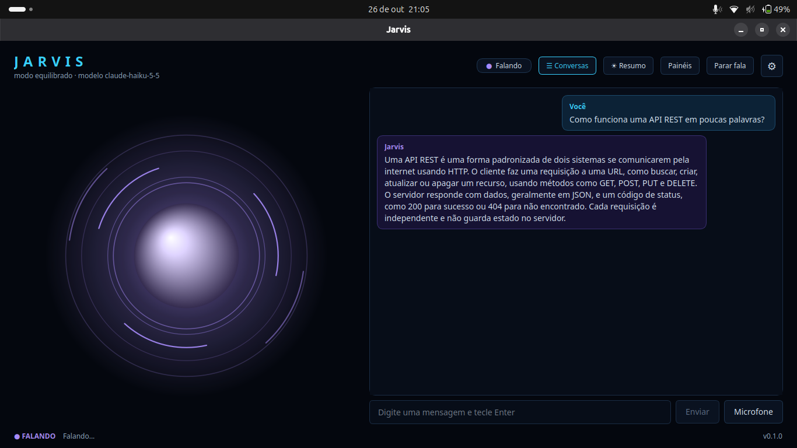

# Jarvis Desktop

Assistente pessoal para desktop, desenvolvido em **Python 3.12+, PySide6 e SQLite**, com foco principal no Windows. O projeto é uma migração incremental de uma versão anterior em HTML/JavaScript, mantendo a ideia de um assistente com interface própria, voz, memória e integrações locais.

O Jarvis combina reconhecimento e síntese de voz executados localmente com uma integração opcional à API da Anthropic. Também pode consultar agenda, e-mails, notícias e clima, além de executar um conjunto limitado de ações autorizadas no computador.

> **Privacidade:** o reconhecimento de voz e a síntese de voz usam modelos locais depois de baixados. Quando o modo de conversa com IA está ativo, as mensagens encaminhadas à Anthropic saem do computador. O Jarvis não envia mensagens ao abrir o aplicativo nem envia transcrições parciais.

## Funcionalidades

- **Interface desktop nativa:** conversa, estado do assistente, configurações e painéis de integração.
- **Entrada de voz em português brasileiro:** microfone, detecção de atividade de voz (VAD), verificação da wake word “Ei Jarvis” e transcrição local com faster-whisper.
- **Voz sintetizada local:** Kokoro-82M via ONNX Runtime, com fila de fala e interrupção imediata.
- **Conversa com IA:** integração com a API da Anthropic, fluxo único para mensagens digitadas ou faladas, controle de contexto e retry manual.
- **Histórico e memória persistentes:** conversas, mensagens e memórias armazenadas em SQLite; as memórias relevantes são selecionadas para cada solicitação.
- **Ações controladas no computador:** abertura de aplicativos, pastas, projetos e sites autorizados; pesquisa no Spotify; fechamento de aplicativos com confirmação.
- **Integrações somente de leitura:** Google Calendar via iCal, Gmail via IMAP, notícias via RSS e clima via Open-Meteo.
- **Resumo da manhã:** reúne agenda, e-mails que exigem atenção, notícias, clima e informações da memória, conforme as configurações.
- **Modos de funcionamento:** Equilibrado, Econômico, Local e Offline.
- **Rotinas e métricas:** sequências de tarefas predefinidas e registro local de metadados de uso da IA.

## Como o fluxo funciona

### Mensagens e IA

Mensagens digitadas e transcrições concluídas passam pelo mesmo serviço de mensagens. Cada envio recebe um identificador e entra em uma fila serial. Primeiro, o roteador local verifica se o pedido pertence a uma capacidade implementada localmente, como uma ação autorizada ou uma consulta de integração. Quando necessário e permitido pelo modo atual, o conteúdo segue para a API da Anthropic.

A resposta é apresentada na conversa e pode ser falada pelo TTS. O texto produzido pela IA **nunca é interpretado como comando do computador**. Se uma chamada falhar, o Jarvis apresenta o erro e permite uma nova tentativa explícita; não repete automaticamente a chamada, pois um timeout não garante que a API deixou de processar a solicitação.

### Entrada de voz

O fluxo de áudio é:

`Microfone → VAD → verificação da wake word → captura do comando → STT → fluxo de mensagens`

O aplicativo mantém estados como `IDLE`, `WAITING_WAKEWORD`, `LISTENING_COMMAND`, `TRANSCRIBING` e `ERROR`. O botão **Microfone** também permite testar um comando sem dizer “Ei Jarvis”. Durante a reprodução da voz do assistente, a captura é suspensa temporariamente para reduzir a transcrição do próprio áudio.

**Limitação da wake word:** “Ei Jarvis” não é detectado por um modelo acústico dedicado. O projeto transcreve pequenos trechos localmente e compara o texto com variações como “ei”, “hey” e “a Jarvis”. Isso adiciona latência e pode fazer com que falas próximas também sejam transcritas.

### Histórico, memória e contexto

O projeto mantém três camadas distintas:

- **Histórico:** registra as mensagens e respostas por conversa no banco local.
- **Memória permanente:** guarda fatos somente quando o usuário pede explicitamente.
- **Contexto da solicitação:** combina as mensagens recentes da conversa ativa com as memórias consideradas relevantes, respeitando limites configuráveis.

Ao reabrir o aplicativo, o contexto é reconstruído a partir de trocas completas. Mensagens sem resposta são exibidas como incompletas e não são reenviadas automaticamente. A memória é gerenciada localmente e pode ser criada, pesquisada, alterada ou removida por comandos em linguagem natural.

## Requisitos

- Python **3.12 ou superior**.
- Windows é a plataforma principal. Algumas funções de sistema têm suporte limitado em Linux e não estão implementadas para macOS.
- Dependências Python listadas em `requirements.txt`.
- Uma chave da API da Anthropic para conversar com o modelo remoto. Sem a chave, o aplicativo ainda pode abrir e usar as funções locais disponíveis.
- Modelos de voz baixados manualmente para ativar STT e TTS locais.

## Instalação no Windows

Execute os comandos na pasta do projeto, usando o PowerShell:

```powershell
py -3.12 -m venv .venv
.\.venv\Scripts\Activate.ps1
pip install -r requirements.txt
Copy-Item .env.example .env
```

Abra o arquivo `.env` e configure a chave da API:

```dotenv
ANTHROPIC_API_KEY=sua_chave_da_anthropic
```

Depois, baixe os modelos de voz que pretende usar (instruções abaixo) e inicie o aplicativo:

```powershell
python main.py
```

Se o PowerShell bloquear a ativação do ambiente virtual, permita a execução apenas na janela atual:

```powershell
Set-ExecutionPolicy -Scope Process -ExecutionPolicy Bypass
```

No Prompt de Comando (CMD), ative o ambiente com:

```bat
.venv\Scripts\activate.bat
```

## Configurar voz local

Os modelos não são baixados automaticamente. O download é uma etapa manual, feita uma vez para cada modelo necessário. Depois disso, o reconhecimento e a síntese podem funcionar sem conexão com a internet.

### Reconhecimento de voz (STT)

Baixe o modelo de entrada. O modelo padrão descrito pelo projeto é `small`; também é possível usar `tiny`, `base` ou `medium`.

```powershell
python scripts/download_model.py small
```

Os arquivos ficam em `assets/models/`. Se o modelo não estiver disponível, o Jarvis informa isso e continua utilizável por texto. Para selecionar outro modelo, ajuste `listening.stt_model` em `data/settings.json`, por exemplo:

```json
{
  "listening": {
    "stt_model": "base"
  }
}
```

No Linux, instale a biblioteca de áudio antes de usar o microfone:

```bash
sudo apt install libportaudio2
```

No Windows, o pacote utilizado pelo projeto fornece o PortAudio necessário.

### Síntese de voz (TTS)

Baixe o modelo Kokoro-82M em sua configuração compacta padrão (int8, aproximadamente 92 MB):

```powershell
python scripts/download_tts_model.py
```

A variante `fp32`, com aproximadamente 310 MB, pode ser escolhida quando a prioridade for maior fidelidade. Os arquivos são armazenados em `assets/models/kokoro/`.

As vozes configuradas no projeto são `pm_alex` (padrão), `pm_santa` e `pf_dora`. Os parâmetros de voz, taxa, volume, pausas e dispositivo de saída são definidos pela configuração de TTS. Sem os arquivos do modelo, o aplicativo abre e informa que a síntese de voz não está disponível.

Na interface, **Testar voz** reproduz uma frase fixa sem chamar a IA. Durante a fala, o botão muda para **Parar fala**; a tecla `Esc` também interrompe a reprodução. As falas são enfileiradas em ordem FIFO, com limite de oito itens, e textos extensos são divididos em frases.

## Usar o Jarvis

### Conversa e modos

O texto digitado e o comando reconhecido por voz usam o mesmo fluxo de mensagens. O aplicativo pode iniciar sem uma chave de API, mas as respostas que dependem da Anthropic exigem uma chave válida.

Os modos disponíveis são:

| Modo | Comportamento |
|---|---|
| **Equilibrado** | Modo padrão de conversa com o conjunto normal de recursos habilitados. |
| **Econômico** | Limita as respostas da IA a até 250 tokens, reduz o contexto e evita chamadas extras de IA para tarefas auxiliares. |
| **Local** | Não envia solicitações à IA remota; utiliza as capacidades locais implementadas. |
| **Offline** | Não envia solicitações à IA remota e limita as integrações aos dados já armazenados em cache. |

Alterar o modo tem efeito imediato e não altera o modelo selecionado, a voz nem as regras de segurança das ações.

### Memória permanente

A memória só é gravada mediante pedido claro. Exemplos de comandos reconhecidos localmente:

- “Lembre que prefiro respostas curtas.”
- “O que você lembra sobre mim?”
- “Liste minhas memórias.”
- “Pesquise minhas memórias sobre estudos.”
- “Altere a memória sobre X para Y.”
- “Esqueça a memória sobre X.”

O Jarvis não guarda senhas, chaves ou tokens como memórias. Se encontrar uma informação semelhante a outra já cadastrada, pode pedir confirmação antes de gravá-la. Se o pedido para alterar ou apagar for ambíguo, apresenta opções identificadas por código e não modifica nada até o alvo estar claro.

A recuperação de memórias é uma busca local por palavras, com normalização de acentos e remoção de termos comuns. Por padrão, são selecionadas no máximo quatro memórias e cerca de 400 tokens estimados para o bloco de memória, respeitando também o orçamento total de contexto. Essas estimativas são locais; os tokens efetivamente usados pela API são informados pelo provedor.

## Ações autorizadas no computador

O Jarvis pode executar apenas ações estruturadas para destinos cadastrados. Ele não oferece um terminal livre, não transforma texto em comandos de shell e não executa instruções retornadas pela IA.

| Pedido de exemplo | Comportamento |
|---|---|
| “Abra o Spotify”, “Abra o Chrome” ou “Abra o VS Code” | Abre um destino autorizado, se estiver instalado e configurado. |
| “Abra a pasta Downloads” | Abre uma pasta cadastrada, desde que esteja dentro de uma raiz permitida. |
| “Abra meu projeto” | Abre um projeto previamente configurado, com o aplicativo indicado quando houver. |
| “Abra o site do GitHub” ou “Abra https://exemplo.com” | Abre uma URL HTTP/HTTPS validada no navegador padrão. |
| “Pesquise Legião Urbana no Spotify” | Abre a página de pesquisa do Spotify; não inicia a reprodução. |
| “Feche o aplicativo Spotify” | Solicita confirmação antes de pedir o fechamento normal do aplicativo. |

### Confirmação de fechamento

Fechar um aplicativo exige confirmação explícita. A interface mostra **Confirmar / Cancelar** e uma contagem regressiva (30 segundos por padrão). Cada confirmação tem um identificador único, vale uma única vez e expira. Uma nova ação ou a troca de conversa invalida a confirmação pendente.

É possível confirmar ou cancelar por texto. Por voz, o Jarvis aceita frases como “confirmo” ou “pode fechar”; um “sim” isolado por voz não é suficiente, para reduzir o risco de confirmação causada por ruído. Se não houver uma confirmação pendente, “sim” é tratado como conversa normal.

A mensagem de sucesso significa que o sistema aceitou o pedido, não que o Jarvis verificou visualmente a abertura ou o fechamento da janela. O fechamento nunca é forçado: no Windows é usado `taskkill` sem `/F`; no Linux é usado `wmctrl` com suporte a X11. Em ambientes sem suporte seguro, o Jarvis informa que não consegue fechar o aplicativo.

### Cadastrar destinos permitidos

Para personalizar aplicativos, pastas, projetos e sites sem alterar o código:

1. Copie `data/actions.example.json` para `data/actions.json`.
2. Edite o arquivo com os destinos que deseja autorizar.
3. Reinicie o aplicativo se necessário para carregar a configuração.

As principais chaves são:

- `apps`: nome, aliases, executáveis candidatos, argumentos fixos, URI e dados necessários para solicitar o fechamento.
- `folders` e `projects`: caminhos cadastrados; projetos também podem indicar um aplicativo de abertura.
- `sites`: URLs associadas a nomes reconhecíveis por voz ou texto.
- `allowed_roots`: raízes permitidas para pastas e projetos. Caminhos relativos, `..` e links simbólicos são resolvidos antes da validação.
- `remove`: remove destinos padrão; `confirm`: exige confirmação para ações selecionadas.
- `confirmation_ttl_s`: prazo da confirmação, configurável entre 5 e 300 segundos.
- `enabled`: desativa o controle do computador quando definido como `false`.

O arquivo `data/actions.json` é uma configuração local e fica fora do versionamento. Destinos inválidos são ignorados e reportados ao iniciar.

**Limitações das ações:** não há controle de mouse ou teclado, reprodução direta de músicas, controle de volume, desligamento do computador, execução de terminal ou controle remoto. Pedidos repetidos em até três segundos são ignorados para reduzir duplicações causadas, por exemplo, pelo eco do microfone.

## Agenda, e-mails, notícias, clima e resumo da manhã

As integrações são opcionais e **somente de leitura**. Sem configuração, o Jarvis explica como configurar cada fonte e mantém disponíveis as outras funções do aplicativo. Os módulos ficam em **Painéis**, com opções em **Configurações**.

### Comandos de exemplo

| Integração | Exemplos de pedidos |
|---|---|
| Agenda | “Quais são meus compromissos de hoje?”, “O que tenho na agenda amanhã?” |
| E-mails | “Verifica meus e-mails”, “Quais e-mails precisam da minha atenção?” |
| Notícias | “Quais são as notícias de tecnologia?”, “Resume as notícias de economia.” |
| Clima | “Como está o tempo?”, “Vai chover hoje?”, “Qual é a previsão para amanhã?” |
| Resumo | “Bom dia.” ou “Faça meu resumo da manhã.” |

### Configuração das fontes

**Google Calendar:** é possível cadastrar até duas agendas. No Google Calendar, abra as configurações da agenda, acesse a seção de integração e copie o endereço secreto no formato iCal. Cole-o em **Painéis → Configurações** e dê um nome reconhecível. Esse endereço permite acessar os eventos da agenda; trate-o como uma credencial.

**Gmail:** habilite IMAP e a verificação em duas etapas na conta Google e gere uma senha de aplicativo. Configure o endereço e essa senha no Jarvis. A senha normal da conta não substitui a senha de aplicativo. A integração lê mensagens, mas não envia, responde, apaga, arquiva nem marca e-mails como lidos.

**Clima:** configure a cidade e, opcionalmente, o código de país com duas letras. O Jarvis informa a localidade encontrada para que seja possível conferir se ela está correta.

**Notícias:** o padrão é tecnologia e economia, com até cinco manchetes por assunto. Os tópicos podem ser alterados nas configurações, separados por vírgulas.

**Resumo da manhã:** pode ser gerado manualmente pelo botão **Resumo** ou pelos comandos acima. Nas configurações, é possível habilitar a geração automática uma vez por dia, ao abrir o aplicativo, e escolher se o resumo deve ser falado. A opção de reescrever o resumo com IA é opcional e faz uma chamada adicional à API.

### Atualização, cache e privacidade

Por padrão, agenda e e-mails são atualizados a cada 15 minutos; notícias e clima, a cada 30 minutos. Os intervalos podem ser alterados em `data/settings.json`, na chave `integrations`. A atualização ocorre em threads de trabalho para que a interface não fique aguardando a rede.

Os resultados são armazenados no SQLite em um registro de cache por serviço, sempre sobrescrito. O cache guarda dados interpretados, trechos de até 240 caracteres por e-mail e não armazena corpos completos nem anexos. Se a rede falhar, os dados anteriores são mantidos e a resposta informa a hora da última atualização. Após uma tentativa de login recusada no Gmail, o Jarvis para de tentar novamente de forma automática até uma atualização manual.

As respostas que contêm dados da agenda ou dos e-mails são marcadas como privadas e não são reutilizadas como contexto da IA. Os e-mails só são enviados à IA quando o usuário pede uma análise que depende disso; nesse caso, o envio fica limitado a um lote de até oito mensagens em situação de dúvida, com assunto, nome do remetente sem endereço e trecho curto. Os modos Local, Offline e Econômico não enviam o conteúdo das integrações à IA.

As credenciais são guardadas no cofre do sistema por meio de `keyring` (no Windows, o Gerenciador de Credenciais). O arquivo `data/settings.json` guarda configurações como nomes, cidade, assuntos e preferências, não as senhas. Se o cofre não estiver disponível, o Jarvis não salva a credencial e avisa. Como alternativa explícita, podem ser usadas as variáveis de ambiente `JARVIS_GMAIL_APP_PASSWORD`, `JARVIS_CALENDAR_CAL1` e `JARVIS_CALENDAR_CAL2`.

**Limitações das integrações:** regras complexas de recorrência do iCal, como `BYSETPOS`, são sinalizadas em vez de interpretadas por aproximação. O fuso horário local usa o deslocamento atual do sistema e não reconstrói regras históricas de horário de verão. O RSS do Google News fornece manchetes e redireciona para os sites de origem. O Open-Meteo é gratuito para uso não comercial; verifique os termos do serviço para o uso pretendido.

## Conversas, configurações, atalhos, rotinas e métricas

### Conversas

O painel **Conversas** lista as conversas armazenadas no SQLite. **Nova conversa** cria um contexto independente; se a conversa atual estiver vazia, ela pode ser reutilizada. Ao abrir outra conversa, o histórico carregado e o contexto enviado à IA passam a ser apenas os daquela conversa. A troca não aciona uma chamada de IA.

É possível renomear e excluir conversas. O título definido pelo usuário não é sobrescrito automaticamente. A exclusão pede confirmação e remove apenas as mensagens daquela conversa, preservando a memória permanente. Se uma resposta de uma solicitação anterior chegar depois da troca, ela é gravada na conversa de origem e não aparece na conversa atualmente aberta.

### Configurações

As opções de modo, modelo, tamanho de resposta, voz, microfone, atalho, histórico, rotinas e métricas são validadas e gravadas em `data/settings.json`. Uma opção que só tem efeito após reabrir o aplicativo informa isso na interface. Chaves e senhas não devem ser colocadas nesse arquivo: use `.env` ou o cofre do sistema.

O cliente de IA usa `claude-haiku-5-5` como modelo padrão descrito na configuração do projeto. Para escolher outro modelo compatível com sua conta Anthropic, ajuste a chave `ai.model` em `data/settings.json`. Por exemplo:

```json
{
  "ai": {
    "model": "claude-sonnet-5-5",
    "disable_thinking": false
  }
}
```

O Jarvis não troca de modelo automaticamente. Consulte a [documentação oficial dos modelos da Anthropic](https://platform.claude.com/docs/pt-BR/models/overview) para verificar identificadores e disponibilidade atuais.

Os parâmetros principais de controle da IA incluem `max_output_tokens` (400 por padrão), `context_token_budget` (3.000 tokens estimados), `max_history_messages` (12) e `max_message_chars`. O número de tokens exibido para chamadas à API vem da resposta do provedor; estimativas locais são identificadas como estimativas.

### Atalho global

O atalho padrão é `Ctrl+Alt+J`. No Windows, ele usa o mecanismo de atalho global do sistema. Em Linux e macOS, o suporte global não está implementado; o Jarvis informa a limitação e oferece um atalho local, válido quando a janela está em foco. O atalho reutiliza a janela e a escuta existentes, sem iniciar uma segunda captura de microfone nem interromper a fala atual.

### Rotinas

É possível montar rotinas com até dez etapas selecionadas de uma lista fixa: consultar agenda, e-mails, notícias, clima e resumo; abrir aplicativo, pasta, projeto ou site; pesquisar no Spotify; e solicitar o fechamento de um aplicativo. Não há suporte a scripts nem a texto arbitrário executável.

Cada etapa passa novamente pelas validações de segurança correspondentes. Uma etapa essencial que falha interrompe a rotina. Se a rotina precisar fechar um aplicativo, ela pausa até a confirmação ser resolvida. Uma rotina pode ser iniciada pelo botão ou por voz, usando, por exemplo, “execute a rotina nome da rotina”. Não há agendamento automático de rotinas.

### Métricas

O painel de métricas registra localmente metadados como tipo de solicitação, modelo, tokens reportados pelo provedor, duração e resultado. O custo é calculado somente se os preços por milhão de tokens de entrada e saída forem informados em `data/settings.json`, na chave `metrics.prices`. Limpar as métricas exige confirmação e não altera o histórico de conversas nem a memória.

## Estrutura do projeto

```text
main.py                         Ponto de entrada da aplicação
app/
  core/
    config.py                   Configurações, caminhos, segredos e parâmetros de voz
    capabilities.py             Fonte das capacidades realmente disponíveis
    intents.py                  Roteamento local de intenções
    conversation.py             Montagem do contexto temporário e orçamento de tokens
    actions.py                  Permissões e validação de destinos
    action_intents.py           Interpretação de pedidos de ação
    integration_intents.py      Reconhecimento de consultas às integrações
  database/
    database.py                 Inicialização e migrações do SQLite
    repositories.py             Consultas SQL parametrizadas
  integrations/                 Agenda iCal, Gmail/IMAP, notícias RSS, clima e resumo
  services/
    assistant_service.py        Entrada única de mensagens e fila serial
    ai_service.py               Cliente da API Anthropic
    history_service.py          Histórico persistente
    memory_service.py           Memória permanente e recuperação seletiva
    action_service.py           Validação final e execução de ações autorizadas
    confirmation.py             Confirmações pendentes com prazo e uso único
    system_backend.py           Ponto controlado de interação com o sistema
    audio_service.py            Captura e seleção de microfone
    vad_service.py              Detecção de atividade de voz
    wakeword_service.py         Verificação da wake word
    stt_service.py              Transcrição local com faster-whisper
    voice_service.py            Pipeline de voz e coordenação com a interface
    tts_service.py              Síntese local, fila e interrupção de fala
    audio_output.py              Reprodução de áudio
    integration_service.py      Atualização assíncrona e cache das integrações
    voice_debug.py              Diagnóstico opcional do reconhecimento
  ui/                            Janela principal, componentes, estilos e pontes da interface
scripts/
  download_model.py             Download manual do modelo STT
  download_tts_model.py         Download manual do modelo TTS
  diagnose_audio.py             Diagnóstico de microfone, ruído e VAD
  stt_benchmark.py              Benchmark de reconhecimento de voz
tests/
  test_voice.py                 Entrada de voz
  test_tts.py                   Síntese e reprodução de voz
  test_assistant.py             IA, roteador, contexto e duplicações
  test_persistence.py           Banco, histórico, memória e concorrência
  test_actions.py               Permissões, confirmação e execução controlada
  test_integrations.py          Integrações e cache, inclusive cenários offline
  test_stage9.py                Conversas, modos, configurações, rotinas e métricas
data/                            Banco e configurações locais (não versionados)
assets/models/                   Modelos de voz baixados manualmente (não versionados)
```

O código foi separado para que a interface emita sinais e apresente estados, enquanto os serviços cuidam de voz, persistência, IA, integrações e ações. A execução de ações no sistema fica concentrada no backend controlado, em vez de ser espalhada pela interface ou pelo serviço de IA.

## Testes e diagnóstico

Execute a suíte de testes a partir da raiz do repositório, com o ambiente virtual ativado:

```powershell
python -m unittest discover -s tests -t .
```

Para investigar problemas de microfone ou comparar modelos de reconhecimento:

```powershell
python scripts/diagnose_audio.py
python scripts/stt_benchmark.py
python scripts/stt_benchmark.py --model base
python scripts/stt_benchmark.py --wav-dir pasta_com_arquivos_wav
```

O benchmark usa sete frases de referência com cinco tentativas e informa o WER (taxa de erro de palavras); a opção `--csv` permite salvar os resultados. Para avaliar arquivos WAV, use o padrão de nomes `01_*.wav`, `02_*.wav` etc., correspondentes às frases de referência.

Para consultar o texto reconhecido em cada trecho, inclusive durante a verificação da wake word, habilite o diagnóstico em `data/settings.json`:

```json
{
  "listening": {
    "debug": true
  }
}
```

Esse modo registra metadados e textos de diagnóstico, mas não grava áudio por padrão. A gravação dos últimos trechos depende de uma opção separada e explícita, `debug_audio_dir`.

## Segurança e privacidade

- **Chave da Anthropic:** configure `ANTHROPIC_API_KEY` em `.env`. Não coloque a chave no código nem em `data/settings.json`. O arquivo `.env` deve permanecer fora do Git.
- **Credenciais de integrações:** ficam no cofre do sistema via `keyring`, ou nas variáveis de ambiente de alternativa descritas acima.
- **Banco local:** histórico, memórias e cache de integrações são armazenados em `data/jarvis.db`.
- **Ações restritas:** não há shell livre nem interpretação da resposta da IA como comando. Os destinos autorizados são validados novamente antes da execução.
- **Confirmação explícita:** o fechamento de aplicativos sempre exige confirmação e nunca usa encerramento forçado.
- **Dados externos tratados como dados:** conteúdo de e-mails, feeds e páginas não é tratado como instrução executável.
- **Diagnóstico de áudio:** a depuração não grava áudio sem uma opção separada habilitada explicitamente.

O arquivo `data/actions.json`, o banco local, as configurações e os modelos baixados contêm dados da instalação e não devem ser publicados sem revisão. Confirme também que `.env`, credenciais e dados pessoais estejam cobertos pelo `.gitignore` antes de enviar o projeto ao GitHub.

## Limitações conhecidas

- A wake word usa transcrição local e comparação textual, não um detector acústico dedicado.
- O reconhecimento de voz pode transcrever falas próximas enquanto verifica a wake word.
- Sem os modelos baixados, a entrada ou saída de voz correspondente não fica disponível; o uso por texto continua possível.
- A aplicação não consegue confirmar visualmente que um aplicativo abriu ou fechou; informa o resultado do pedido feito ao sistema.
- O fechamento seguro depende do suporte da plataforma. No Linux, a implementação descrita requer `wmctrl` e X11; o atalho global é específico do Windows.
- A interpretação de recorrências complexas do iCal é limitada.
- A síntese Kokoro utiliza componentes cujas licenças devem ser verificadas antes de redistribuir um executável. O modelo Kokoro é Apache-2.0 e `kokoro-onnx` é MIT; o fonemizador baseado em `espeak-ng`/`phonemizer` inclui componentes GPL.
- A chamada à Anthropic pode ter sido processada mesmo quando ocorre timeout; por isso, solicitações incompletas não são repetidas automaticamente.

## Estado da migração

O README descreve as funcionalidades das nove etapas de migração documentadas no projeto:

| Etapa | Escopo |
|---|---|
| 1 | Janela inicial, configuração e SQLite |
| 2 | Interface nativa, orb, conversa, entrada e estado |
| 3 | Microfone, VAD, wake word e STT local |
| 4 | TTS neural local, reprodução e interrupção |
| 5 | Integração com Anthropic e fluxo único de mensagens |
| 6 | Histórico persistente, memória permanente e recuperação seletiva |
| 7 | Ações autorizadas no computador e confirmação de fechamento |
| 8 | Agenda, e-mails, notícias, clima, resumo e cache |
| 9 | Conversas, configurações, modos, atalho, rotinas e métricas |

A versão anterior em HTML/JavaScript e os arquivos `server.js` e `jarvis_actions.json` permanecem fora desta pasta como referência para a migração.

## Licenças

Antes de distribuir o aplicativo ou empacotá-lo como executável, confira as licenças de todas as dependências, modelos e componentes de áudio utilizados, especialmente os componentes GPL relacionados à fonemização. A licença do próprio projeto deve ser definida separadamente caso o repositório seja distribuído publicamente.
